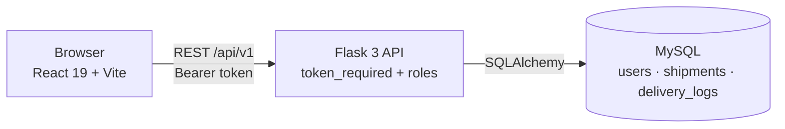
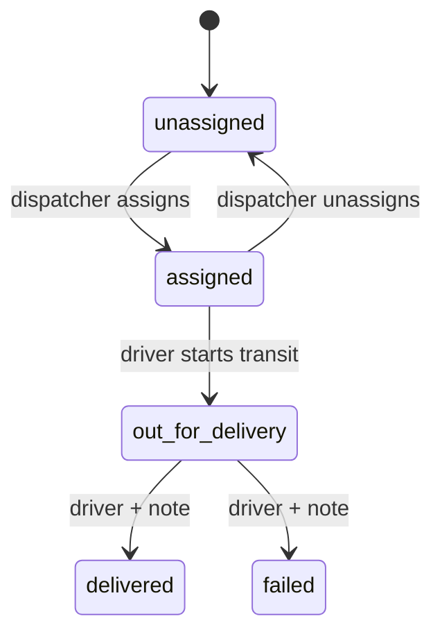

  

  

  
  
  
  

## 👋 About me

I'm a **Computer Science and Engineering student** who likes turning a question into a working system: a React and Flask platform with role-based access, a model that answers a farming question, a camera that names colours, or a notebook that tests a hypothesis.

---

## 🚚 Flagship: [FleetSync](https://github.com/kalaigarmukhtarahmed/Fleetsync)

A logistics platform with three views over one shipment database: **dispatchers** assign and monitor, **drivers** see only their own deliveries, and **anyone** can track a parcel by number. *(Documented from the repository's README, roadmap and test page.)*

Every status change writes a delivery-log entry, and the public tracker shows that same timeline.

---

## 🧩 Projects

| Project | What it does | Stack | Evidence |
|---|---|---|---|
| [**FleetSync**](https://github.com/kalaigarmukhtarahmed/Fleetsync) | Role-based logistics platform | React · Flask · MySQL | Documented |
| [**CodeEval-AI**](https://github.com/kalaigarmukhtarahmed/CodeEval-AI) | Scores the quality of an uploaded Python repository | FastAPI · React · Ruff · Bandit | Documented |
| [**AgroPredict-ML**](https://github.com/kalaigarmukhtarahmed/AgroPredict-ML) | Checks if a crop suits the land and recommends another | Flask · scikit-learn | ✅ Source-verified |
| [**Color-Detection-Project**](https://github.com/kalaigarmukhtarahmed/Color-Detection-Project) | Names colours in a live webcam feed | OpenCV · NumPy | ✅ Source-verified |
| [**Hospital-Employee-Attrition-Analysis**](https://github.com/kalaigarmukhtarahmed/Hospital-Employee-Attrition-Analysis) | Statistical study of attrition in synthetic data | Pandas · SciPy · Seaborn | Documented |
| [**mnc-it-employee-attrition-data-analysis**](https://github.com/kalaigarmukhtarahmed/mnc-it-employee-attrition-data-analysis) | Data-preparation walkthrough | Pandas · scikit-learn | Documented |
| [**Swiggy-Sales-Analysis**](https://github.com/kalaigarmukhtarahmed/Swiggy-Sales-Analysis) | Cleaning and business questions on food-order sales | Pandas · Jupyter | Documented |
| [**Java-program**](https://github.com/kalaigarmukhtarahmed/Java-program) | Interface and inheritance practice | Java | ✅ Source-verified |

**Source-verified** means the code was read. **Documented** means the description comes from the repository's README or notes.

---

## 🛠️ Tech stack

---

  <a href="https://kalaigarmukhtarahmed.github.io"><b>🌐 Interactive portfolio</b></a> ·
  <a href="https://github.com/kalaigarmukhtarahmed?tab=repositories"><b>📂 All repositories</b></a>

